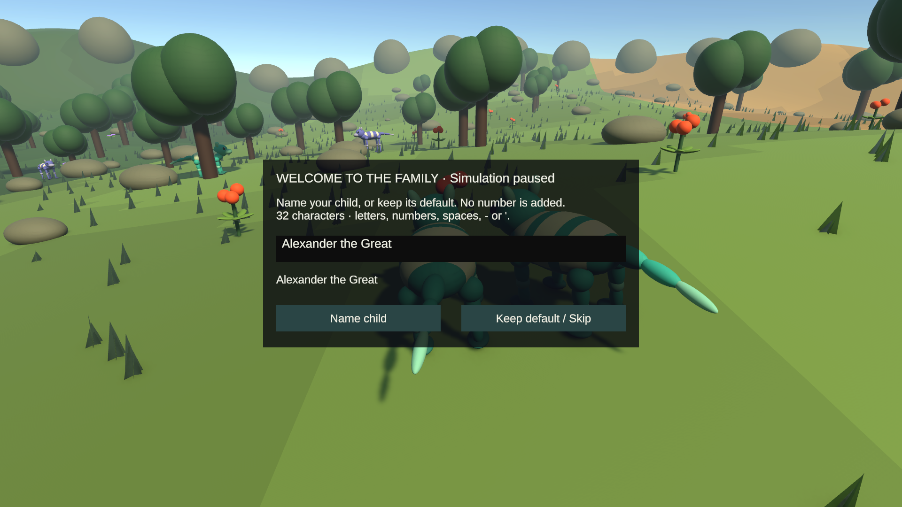
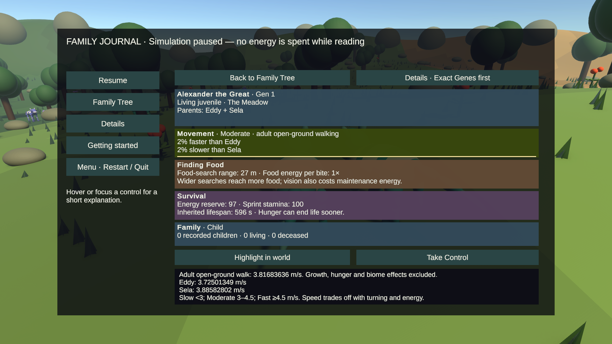
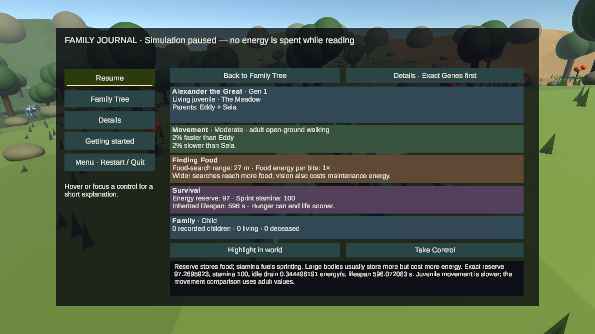
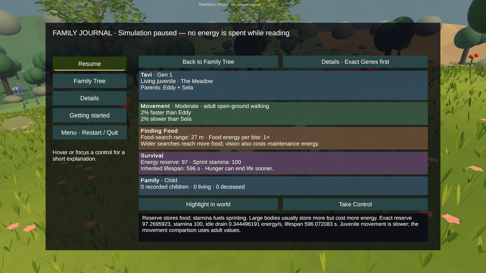
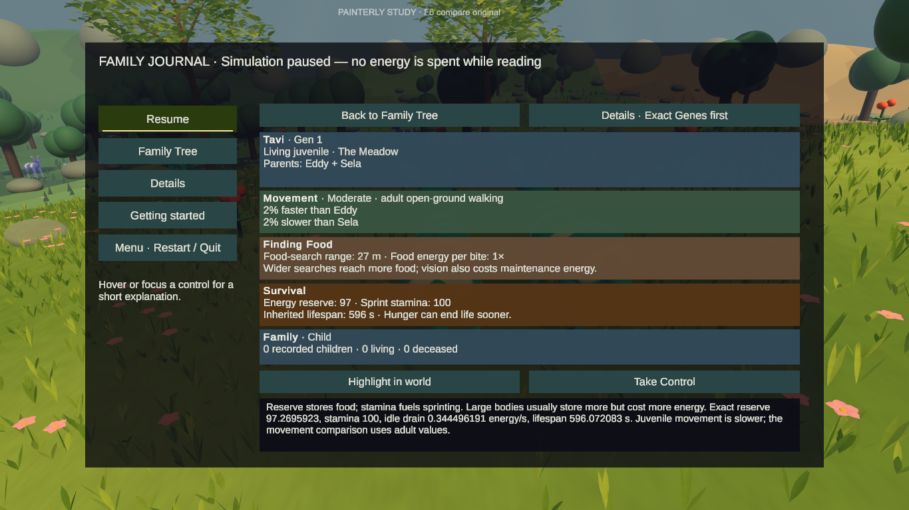
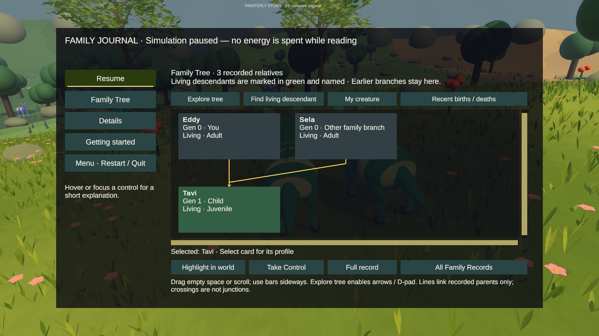
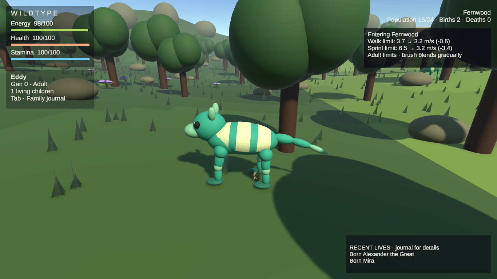
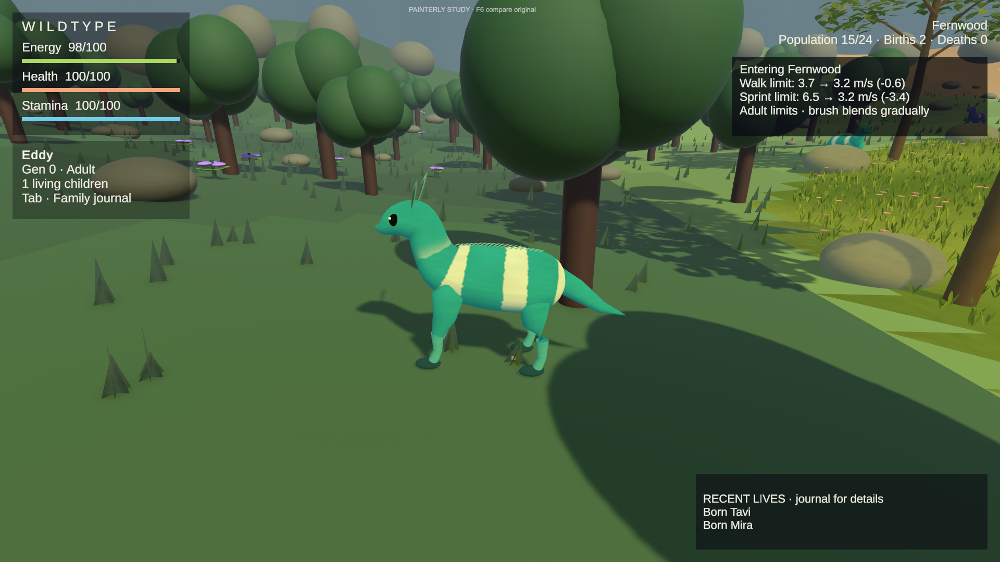

# Clear creature profiles and biome feedback — 2026-09-26

## Starting point and scope

Local and remote `milestone-scrollable-family-tree` both resolved to `c23923dde088114a6183d1b5a34858d134eabaed` before editing. Work is on the separate `milestone-creature-profiles` branch. Main remains `d768797775ad0a7b802eaec0f50899e5d3e2e0df`; no main merge, history rewrite or force-push.

Inspected the saved original and painterly scenes, journal/Details/tree, naming storage and input field, world labels, ancestry records, phenotype, movement and ecology rules, tests and prior verification. Only presentation code, presentation regression tests and documentation are intended for this commit. No assets, packages, simulation rules, camera/F6 behavior or separate RunAudit files were edited for this milestone.

## What changed

- A Family Tree card opens five stacked profile cards: Identity, Movement, Finding Food, Survival and Family. Both target resolutions use a focused view rather than squeezing the tree beside the profile. Back restores tree position and the selected stable identity.
- Movement compares adult open-ground walking limits with each available named parent. Slow means below 3 m/s; Moderate is 3 to below 4.5; Fast is at least 4.5. These are presentation categories, not fitness scores or new simulation rules. Percentages preserve small differences; help retains exact values. Growth, hunger and regional effects are excluded from this comparison.
- Food-search range is explicitly the autonomous search radius, not camera zoom or eating reach. Reserve, stamina and lifespan summaries use existing phenotype values and explain costs rather than calling inheritance an improvement.
- Hover, keyboard focus and activation reveal the relevant explanation directly. Selection clears previous profile help. Exact Genes remains Details page 1; subsequent parent/mutation, resource and identity/death records remain available.
- Automatic birth-order suffixes are removed through the shared name formatter; stored birth order and IDs remain unchanged. Typed digits remain. Names allow 32 characters, with the limit and accepted characters stated during entry. The TMP input field explicitly permits spaces; `Alexander the Great` was entered and confirmed natively. Compact tree cards alone use a 22-character ellipsis presentation; full-name hover/focus and profile text use the accepted stored name.
- The ordinary family HUD grows vertically only when the accepted name wraps, keeping the full name readable after control transfer instead of truncating it or overflowing its original fixed box.
- World child, mate and Locate labels add a short ID only when a living namesake is within 25 m of the player. Full identity records still contain the run-specific stable ID. Gameplay targeting never uses names.
- A restrained top-right notice samples the existing `EcologyRules.TravelLimit` for adult walking and sprinting. Fernwood brush blends from x=-35 to -43 and limits travel using turning capability. The Meadow and Amber Flats do not receive invented penalties. A crossing must remain at least 1 m inside the new region for 0.6 seconds; the notice samples the ongoing blend, lasts 7 seconds with fades, and has a 10-second repeat cooldown. Pause freezes timing; a new archive, controller or dead controller clears it. This is a readout only, not a modifier.

## Rendered inspection and assistance

Used native Unity mouse clicks and keyboard input in the actual saved scenes, with the existing local dirty assets. Inspected selected juvenile profiles at **1920×1080 and 1366×768 in both scenes**. Text and actions fit, the scenery remains visible behind the journal, and the focused profile avoids narrow columns. Exact help is necessarily denser than the short cards.

Native actions included starting as Eddy, typing and confirming `Alexander the Great`, accepting an unsuffixed default newborn name (Tavi), opening Tab, clicking the child card, reading Movement help, pressing Down to switch to Finding Food help, opening Exact Genes first, changing Game-view resolutions, and returning to the tree. Native return testing exposed a selected-ID issue, repaired by saving the clicked identity rather than the previously focused one. A fresh run after recompilation confirmed Back showed **Selected: Tavi**, not Eddy.

Birth setup was **assisted**: a temporary Editor helper placed the player and a partner together, replenished energy, disabled autonomous decisions for inspection, and called the existing mating entry point. Normal courtship, inheritance, birth and the player-facing naming prompt then ran. This is not a natural multi-generation survey or human usability test.

The original scene's biome crossing was captured at 1366×768; the painterly scene's at 1920×1080. Each was **assisted setup and queued input**: placement at x=-33, energy replenishment and a virtual held A key, followed by the actual player input/motor crossing to x=-43.05079. Both recorded motor speed approximately 3.149987 m/s, with the existing adult walk/sprint limits reduced by brush. The notice showed the running blend, then disappeared. No teleport across the boundary, stat override or changed movement formula was used. Frame captures are actual Unity Game output, not recreated UI mockups.

The temporary helper and its meta were moved out of Assets before the final complete suites. A transient file-sharing exception in that helper occurred while its request file was rewritten; it was not a runtime game exception and the helper is not delivered. No runtime errors appeared in the inspected final fresh Play session. No physical gamepad or independent novice usability session was performed; gamepad input/navigation coverage is automated.

### Running-scene evidence

Before this pass, selecting a tree card opened dense identity Details directly; the prior milestone's [rendered evidence](../ScrollableFamilyTree/REPORT.md) remains available. No fabricated before screenshot is supplied.

## Automated verification

Final complete suites, after removing the temporary helper and applying the final layout fix:

| Suite | Passed | Failed / skipped | Test duration |
| --- | --- | --- | --- |
| Edit Mode | 150 / 150 | 0 / 0 | 3.0887854 s |
| Play Mode | 56 / 56 | 0 / 0 | 557.3802704 s |

Both Unity processes exited 0. These durations exclude import/startup. Raw XML and logs remain in the task backup directory as `edit-final2.xml/.log` and `play-final2.xml/.log`. Complete suites include the existing genetics, ecology, care, ancestry, camera, painterly and bounded-population regressions, not only the new presentation tests. No temporary fixture remains in Assets.

New Edit Mode coverage: spaces and typed digits, unsuffixed formatting, named two-parent comparison formatting and small percentages, rating thresholds, unchanged genome values, actual region/blend differences, no dry-region penalty, boundary debounce, pause, expiry and identity/run resets.

New Play Mode coverage: clicking a child from a parent-selected tree opens that child's profile, adult comparisons for a juvenile, both parent names, exact help through pointer/focus, stale-help clearing, Exact Genes first, return position/selection, Highlight without transfer, Take Control with stable names, unavailable versus recorded unknown death, restart/reseed and existing caps; duplicate 32-character names, adult growth and identity disambiguation. Existing naming/UI expectations were updated to the requested no-suffix/profile behavior, not weakened simulation assertions.

Intermediate verification: first full Edit run 150/150 passed. First focused Play run 4/7 passed: two new fixture setup failures from a missing player AI component and one naming-instruction overflow. Guarded the absent AI component and shortened the instructions; focused rerun 7/7 passed in 32.054194 s. The later native selection fix and long-name test were included in the final complete runs.

First complete Play run: 54/56 passed in 556.6736381 s. One older Chronicle assertion still expected `Absent 1`; it now explicitly checks the unsuffixed name and absence of the suffix, retaining the unavailable/death-evidence assertions. The new long-name fixture used 33 characters while expecting 32-character storage; changed it to the exactly 32-character `Alexandra the Extraordinary Fern` and asserted the fixture length. No simulation behavior was changed to satisfy these tests.

Focused rerun: 5/6 passed in 48.6587988 s. With the corrected fixture, the long-name test reached control transfer and caught genuine overflow of the ordinary family identity panel. The panel now measures its text and expands vertically only as needed. This final 32-character HUD fix is covered by rendered text-fit automation, not a separate native human walkthrough; the native entered-name inspection used `Alexander the Great`.

All three focused profile tests then passed in 17.8284222 s before the final full rerun.

## Protected local files

All nine initial dirty paths were copied with their relative paths to `C:\Users\jsayl\AppData\Local\Temp\WildTypeProfiles-20260926` before milestone edits. None is staged. The unresolved original sun component and scene/prefab serialization changes remain local; this task neither resolves nor folds them into presentation work.

| Protected path | Starting SHA-256 |
| --- | --- |
| `Assets/ThirdParty/UnityTextMeshPro/Resources/Fonts & Materials/LiberationSans SDF - Fallback.asset` | `A5504615B989E02CFE23A1066497FFAAB2819FC16A602F5E0DE5EF4A3CFCFDFD` |
| `Assets/WildType/Materials/Interaction gold.mat` | `4297FF229276B9A0F3165110DF6CBAE3BAF893697C02367CC062DEB49462D28F` |
| `Assets/WildType/Prefabs/Environment/PrototypeTree.prefab` | `683376F21C75A95DA83D7B016345FF90E537F4A059729BE832069D2C6F7BBA66` |
| `Assets/WildType/Prefabs/Food/Brightfruit.prefab` | `A2533897380FA5D083CC9FEE02C34C5ECD69E86BFE082AF3F4B26990F96EEDCB` |
| `Assets/WildType/Scenes/CreatureStage_Prototype.unity` | `6115D05D1CF5C17E3819DA13224A16A353F111F86F8D365237CF3E7FBC8AFBAA` |
| `Assets/WildType/ScriptableObjects/Amber Bulwark.asset` | `2A58674D432E0614019EF7D8F8A3F08DDDB3613FDC65E286E52242D94788B0C5` |
| `Assets/WildType/ScriptableObjects/Meadow Grazer.asset` | `32DCC8D3D3CB434D5C4F5757EB8009059BD303A90ED6753E0C1C03DBAAEBDC80` |
| `Assets/WildType/ScriptableObjects/Violet Strider.asset` | `213ED18D9C29A56BB49EC003F18A0AB7CD8BA75C187C3C74CE3AF7CE45C56570` |
| `ProjectSettings/EditorBuildSettings.asset` | `EE752D01F7CEF9207F9E3549EB4022B9066C819DECA1AD164A3536EE3B448810` |

Final SHA-256 comparisons matched **all nine files byte-for-byte to the task's starting backups**. After all Unity processes exited, the regenerated fallback font was preserved separately as `Unity-generated-fallback-after-tests.asset`, then the exact starting font was restored. Unity is left closed to prevent regenerating that protected asset again before handoff. None of the nine protected paths is included in the milestone commit.

## Remaining limits

- The archive stores birth-comparison text, not a full genome snapshot for every deceased actor. Live profiles compare available actors; unavailable/deceased parent comparisons explicitly say unavailable and direct the player to retained birth records. No current statistics or death is invented.
- Movement categories describe adult open-ground walking only. They do not predict survival or say a faster descendant is better. Biome notice endpoints and deltas are independently rounded, so displayed subtraction can differ by 0.1 m/s; exact simulation values are unchanged.
- Both resolutions use the focused profile, not an optional side-by-side 1080p layout. The unchanged Exact Genes page remains denser at 1366×768.
- The tree still needs horizontal navigation for broad families; nearby world labels can overlap. Duplicate-name cues are local; full records remain the definitive disambiguation.
- Rendered evidence used the user's protected local scene/assets, not a clean-clone visual comparison. No art, ecology balance, survival or camera work is included.
