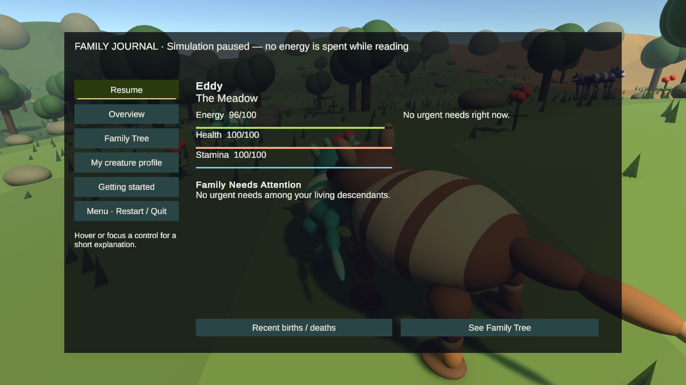
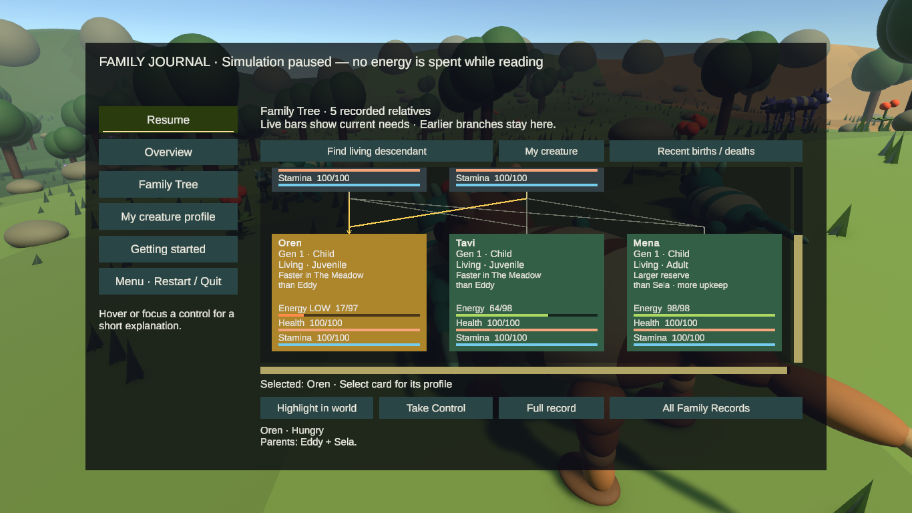
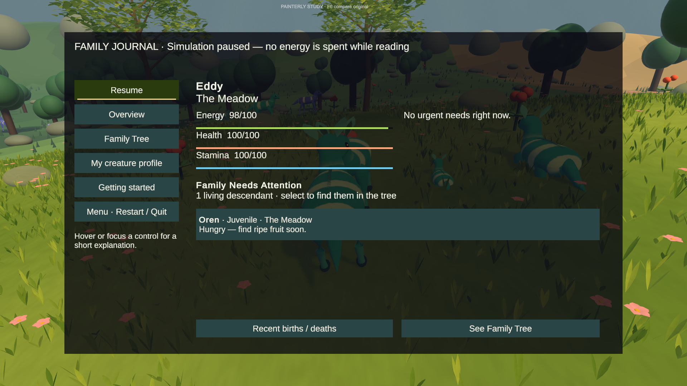
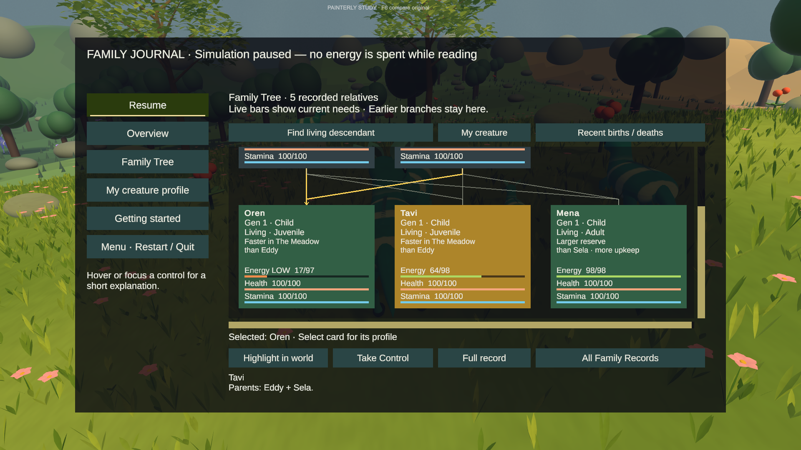
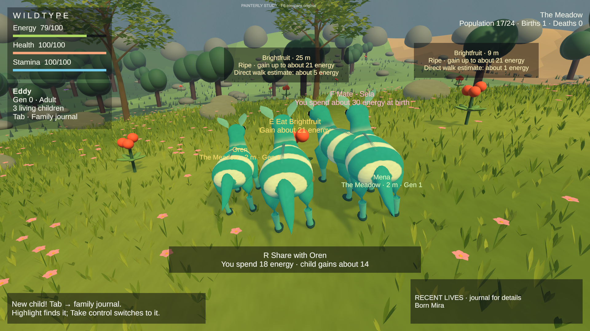

# Journal overview, family needs and safe mate selection

## Starting state and scope

Local HEAD and GitHub `milestone-foraging-decisions` were both **0ce86c47dee42269906d470855247af68a5c6366** before editing. Work is on **milestone-family-overview**. No main merge, force-push, history rewrite, asset replacement or RunAudit change.

Inspected the two saved scenes in native Unity Play Mode before applying source changes, plus the journal/profile/navigation, live world cues, food reach, mating/courtship, AI search, two-parent archive and existing regression tests. The old journal opened directly in the tree; current resources were absent from its cards. Mating checked readiness and genetic compatibility but not biological kinship. Food prompts used real eating range but appeared abruptly. The prior report's protected files remain local rather than being silently incorporated.

All nine starting dirty paths were copied with SHA-256 comparison to `C:\Users\jsayl\AppData\Local\Temp\WildTypeOverview-20260927` before source edits. This run's protected scene, two prefabs and dynamic font have different bytes from the previous report; the current task-start copies, not older backups, are authoritative. Their intent was not reinterpreted in this UI/rules milestone.

## Exact changes

- Tab opens a paused **Overview** with the controlled creature's name, region and live Energy, Health and Stamina. A bounded three-entry needs list uses the existing warning thresholds: Energy at or below 25%, Health below 60, or the existing sprint-exhaustion lock. Names link to the same stable individual in the tree. The count reveals additional needy descendants; the full tree remains accessible. Hungry juveniles/direct children receive priority. Healthy descendants are not given invented needs, and a quiet page does not predict survival.
- Living tree cards gain labeled resources and an explicit **Energy LOW** indicator. Taller fixed-size cards preserve names, generation, relationship and the inherited comparison. Missing/deceased actors have no live bars. Reading, selecting and navigating are resource-neutral.
- Removed the Explore Tree and profile Scroll Up/Down buttons. Right from the Family Tree menu enters a visible card, arrows/D-pad move among cards, Left at a row edge exits to the menu, and Down at the bottom reaches actions. Wheel, dragging and scrollbars remain. Profile Page Up/Down and right-stick scrolling reach long expanded records independently of focus navigation. No gameplay binding was replaced.
- Immediate food offers enter at **90% of real eating reach**, stay offered only through the real range and actual eating eligibility, and fade over approximately **0.2 seconds**. Leaving range immediately removes the action key; only the plant name finishes fading. Re-entry requires the inner threshold, avoiding key-offer flicker at the outer edge. Pause, controller change and invalid targets clear the cue. Limited, Vision-bound scouting observations remain unchanged. Nearby immediate labels are separated modestly where they overlap.
- A single archive-based kinship predicate blocks ancestors/descendants at any depth, full/half siblings, aunt/uncle with niece/nephew, and first cousins (including half-cousin paths). The check is symmetric and considers both parent links. Archived deaths do not erase evidence. Missing links are not invented. First cousins once removed, great-aunt/uncle pairs and second cousins are not rejected solely for those distant relationships; any additional prohibited relationship still rejects them.
- Partner discovery, player offers, AI target retention, courtship start, continuing courtship and final birth validation use this rule. Rejection occurs before reservation and before genome sampling, energy charges or child creation. Genetic compatibility and all existing age/health/energy/cooldown/range/cap rules still apply. Names, shared founder labels and UI-family membership have no role in this decision.

Care accounting, genetics/mutation, food availability/regrowth, movement/camera/zoom, inherited tradeoffs, survival, F6 and the **24 living / 32 actor objects / 72 food / 512 ancestry** limits are unchanged. No free mates, replacement creatures, cutoff relaxation or survival retuning were introduced.

## Verification

Final complete Edit Mode: **172/172 passed**, zero failed/skipped, **3.0965806 seconds**, exit 0. Final complete Play Mode: **65/65 passed**, zero failed/skipped, **577.0805954 seconds**, exit 0. Final focused Play Mode: **5/5 passed**, **9.0925266 seconds**, before the complete final run. The temporary inspection helper and its `.meta` were removed before these final runs. Raw XML and logs remain in the task backup (`edit-final.xml`, `play-final.xml`); machine-specific logs are not committed.

Initial complete Edit Mode run: **172/172 passed**, 3.1869053 seconds, exit 0. The first focused Play fixture exposed a missing null guard on the test player's absent AI component; only that fixture was corrected. The next run passed mating rejection and food prompt checks and exposed an actual tree-help text overflow for simultaneous hunger and low health. The compact help line was repaired without changing warnings or resources.

The first complete Play Mode run was **62 passed / 1 failed** (569.1862817 seconds). Its only failure was the old FamilyCare test's hard-coded 148-pixel tree-card height. The card is intentionally taller to hold resources; that assertion now references `FamilyTreeLayout.CardHeight` while retaining its font and overflow checks. The kinship tests and all three autonomous survey seeds passed in that run. The rendered crowded-label check subsequently exposed a child/mate text collision; bounded separation now keeps immediate food/mate labels and child labels apart, with child displacement downward to avoid the higher scouting observations. A regression assertion covers that case.

### Automated coverage and its limits

Sixteen focused Edit cases cover symmetric ancestor/descendant, full/half sibling, aunt/uncle, full/half first-cousin paths; permitted second cousins, first cousins once removed and unrelated founders; retained dead ancestors; unknown IDs; a deep chain at the 512-record cap and a fresh archive. These are rule checks, not claims of real-world biological compatibility.

Five focused Play tests exercise player and AI rejection; no hearts, reservation, birth charge or offspring; partner death cancellation; adversarial kinship revalidation during courtship; actual bars and fill fractions as energy/stamina change; pause and resource-neutral reading; dead and missing actors without invented death; control transfer; restart/reseed; menu-to-card navigation and exit; close-food eligibility, fade and hysteresis; crowded child/mate spacing; and virtual gamepad right-stick / keyboard Page Down scrolling through expanded records. Existing suites retain genetics, exact profile records, tree relationships/pooling, ecology, care accounting, naming, controls and long-run bounds checks.

Layout assertions check TextMeshPro overflow and the UI reference-size fit at both target aspect ratios. They are not substitutes for rasterized Game-view inspection. No physical controller was available: gamepad verification is injected Input System device state, not a human pad session.

### Rendered Editor observations

Used Unity **6000.4.7f1 Personal**, native Editor Play/Stop and mouse/keyboard controls through the computer-use skill. Both saved scenes were opened before editing and after changes. The original was inspected at **1366×768** and the painterly comparison at **1920×1080**. No saved scene was changed for inspection.

- Fresh run, native **Continue as Eddy**, then **Tab**: Overview appears paused with current bars and a quiet family area. Energy remains unchanged while reading. The original screenshot shows 96/100 Energy, 100 Health and 100 Stamina.
- Assisted three-child family: two juveniles and one adult with genuine inherited genomes, stable parent links and cosmetic names were registered, their resources set to 18%, 65% and full, and AI movement disabled for inspection. This bypassed natural courtship/birth cost and is **not** a natural three-birth playthrough. Selecting hungry Oren in Overview with a native click centered Oren in the tree. Cards showed approximately 17/97, 64/98 and 98/98 Energy, with no control or care transfer. The low child had a textual LOW marker, not only a different color.
- Native menu focus plus Right entered tree cards; Left returned to the menu. Native mouse-wheel scrolling reached an expanded family record with its stable ID and parents. A quick native Page Up tap did not provide conclusive visible movement, so held-key/right-stick scrolling is supported by the automated device-state test, not claimed as a physical-input observation.
- Assisted close-range plant and adult direct child in **both scenes**: native **F** produced the close-relative rejection, with no F Mate offer or hearts. In the original scene, native **E** consumed the plant and restored the player to full Energy; the E prompt disappeared. Assistance supplied placement/resources and the adult-child age, not a replacement for the actual F/E input path.
- Final painterly crowded check placed an eligible unrelated founder mate, hungry juvenile and adult child near the player/ripe food. E Eat, F Mate and R Share showed distinct targets and costs; displaced child labels no longer collided with the mate or food text in that observed camera view. The retained distant observations remained separate dark panels without an E offer. A pending normal AI courtship completed during this setup; the displayed birth counter is not the number of assisted children.

These are agent-operated rendered checks and assisted fixtures, **not human usability testing**. No forced death from a visual fixture was used to justify survival tuning. The helper was removed recoverably to the task backup outside Assets before final tests.

### Running-scene evidence

Unedited Game-view captures; the family/close-interaction states are assisted as described above. Hover can color one card yellow while the explicit Selected line retains another identity; only selection determines the actions.

### Remaining limits

- Kinship reduces possible pairings; the finite three-seed runs cannot establish long-term genetic diversity or rule out later mating bottlenecks. No unrelated replacements are spawned.
- Overview shows the first three current needs and an accurate total, not remote treatment or an urgent promise that care will save someone. Health and exhaustion can have different needs from hunger. Use the full tree for the rest.
- Taller cards require more vertical scrolling. At 1366×768 the resource labels are compact but fit; a novice-player review and physical gamepad session are still warranted.
- Label displacement is bounded, not a global screen-space label solver. Extreme camera angles, many overlapping cues and bright creature surfaces can still reduce readability. It does not alter world positions, sensing or interaction eligibility.
- The current protected local asset versions were the rendered/tested environment; they remain outside this source milestone, so a clean repository clone may differ in those pre-existing visuals/settings.

### Historical baseline and first post-change survey

Same existing seed/duration/setup as the prior milestone, not a bit-identical deterministic experiment. The real physics/AI scene survey has previously shown run-to-run variation. Figures are observations, not proof of adaptation or isolated causal birth-count changes.

| Seed | Prior births / deaths / end living | First post-change births / deaths / end living | Prior / new longest vacancy-to-birth | New post-120s population range |
|---|---|---|---|---|
| 917430 | 49 / 38 / 24 | 48 / 37 / 24 | 17 / 54 s | 20–24 |
| 925349 | 50 / 39 / 24 | 44 / 33 / 24 | 19 / 38 s | 20–24 |
| 933268 | 44 / 33 / 24 | 47 / 37 / 23 | 13 / 25 s | 21–24 |

All new observed deaths in these first runs were old age (zero starvation/unknown), compared with 2, 1, 0 starvation in the prior final survey. Generations reached 7 in all three; replacement births after first death were 37, 33, 36. Peak actor objects 26, 25, 25; archive records 61, 57, 60; food stayed at 72. This does **not** demonstrate food-driven selection. Longer vacancies and reduced permitted pair counts are a balance risk, not grounds to weaken the requested relationship rule.

At the final 1,200-second samples, adult pairs permitted by kinship alone numbered **97 / 94 / 52**, among **22 / 23 / 19** adults respectively. These are not immediately usable mates: genetic compatibility, readiness, distance, other courtships and population space still matter. Sampled actors with an otherwise eligible partner inside Vision ranged **0–1 / 0–2 / 0–4**. Zeros at full capacity do not mean biological extinction. Sampling is every 100 seconds and can miss opportunities between samples; no remote knowledge is given to creatures.

First post-change food slot minimum / mean / maximum:

| Seed | The Meadow | Amber Flats | Fernwood |
|---|---|---|---|
| 917430 | 4 / 12.75 / 32 | 3 / 7.69 / 12 | 7 / 14.70 / 28 |
| 925349 | 2 / 11.86 / 32 | 1 / 6.17 / 12 | 6 / 15.49 / 28 |
| 933268 | 1 / 9.73 / 32 | 0 / 4.96 / 12 | 7 / 15.77 / 28 |

### Final complete-suite survey repeat

No biological cutoff, food or survival tuning occurred between the first and final survey; intervening changes concerned UI spacing, profile scrolling tests and the outdated card-height assertion. The final repeat again used the existing 1,200-second runs. Different physics/AI outcomes are reported rather than hidden.

| Seed | Final births / deaths / end living | Starvation / old age / unknown | Post-120s living range | Highest generation | Replacement births | Longest vacancy → birth |
|---|---|---|---|---|---|---|
| 917430 | 49 / 39 / 23 | 0 / 39 / 0 | 21–24 | 8 | 38 | 16 s |
| 925349 | 49 / 38 / 24 | 1 / 37 / 0 | 20–24 | 9 | 38 | 38 s |
| 933268 | 46 / 36 / 23 | 0 / 36 / 0 | 20–24 | 9 | 35 | 23 s |

The historical baseline's births were 49 / 50 / 44; final births are 49 / 49 / 46. This is not evidence that the rule has no long-term cost. The first repeat reached 54 seconds for a vacancy; the final second seed reached 38 seconds against the prior 19 seconds. Overall reproduction continued, without lowering the cutoff or injecting replacements. The single final starvation is not proof of selection or adaptation.

| Seed | Final adults | Adult pairs allowed by kinship alone | Sampled actors with eligible mate in Vision, range | Peak objects / archive records | Region crossings |
|---|---|---|---|---|---|
| 917430 | 20 | 87 | 0–0 | 26 / 62 | 637 |
| 925349 | 22 | 65 | 0–3 | 25 / 62 | 716 |
| 933268 | 19 | 65 | 0–1 | 26 / 59 | 601 |

The 100-second local-mate samples are snapshots: a zero throughout the first seed's sampled instants plainly does not mean there were no births between samples. Pair counts exclude only biological kinship and juvenile/dead actors; they do not predict usable mates under all other rules. Unchanged caps held: 24 living including reservations, 32 actor objects including reservations, 72 food objects and 512 ancestry records.

| Seed | The Meadow ripe min / mean / max | Amber Flats | Fernwood |
|---|---|---|---|
| 917430 | 1 / 9.04 / 32 | 0 / 5.77 / 12 | 6 / 15.53 / 28 |
| 925349 | 1 / 7.26 / 32 | 0 / 5.05 / 12 | 5 / 16.53 / 28 |
| 933268 | 4 / 11.93 / 32 | 1 / 4.81 / 12 | 6 / 16.11 / 28 |

## Changed-file map

- `Scripts/Creature/LineageArchive.cs`: recorded two-parent kinship predicate.
- `Scripts/Core/GenerationLoop.cs`, `Scripts/AI/HerbivoreBrain.cs`: consistent partner/courtship enforcement.
- `Scripts/Core/PlayerInputBridge.cs`: journal opens Overview.
- `Scripts/UI/StageHud.Overview.cs` (and `.meta`): Overview, needs list, reusable resource bars.
- `Scripts/UI/StageHud.cs`, `StageHud.Tree.cs`, `StageHud.Profile.cs`, `FamilyTreeLayout.cs`: integration, larger resource cards and direct navigation/record scrolling.
- `Scripts/UI/FamilyWorldCues.cs`: close-action fade/hysteresis and bounded label separation.
- `Tests/EditMode/KinshipTests.cs`, `Tests/PlayMode/FamilyOverviewPlayTests.cs` (and metadata): focused rules/UI/lifecycle/navigation coverage.
- `Tests/PlayMode/BalanceSurveyTests.cs`: sampled mate diagnostics only; no relaxed population assertions. `ClarityPlayTests.cs`, `GenerationTests.cs`, `FamilyCarePlayTests.cs`: expectations updated for Overview and taller cards.
- Root README/VERIFICATION and this documentation folder: instructions, measured results and five rendered captures. Script/test paths above are relative to `Assets/WildType/`.

No scene, prefab, material, mesh, genome preset, package, project setting, generated cache or separate project is part of this commit.

## Protected starting hashes

**Final result: all nine paths match these task-start SHA-256 hashes byte-for-byte and remain unstaged/uncommitted.** Unity's regenerated dynamic font was copied to `generated-font-after-final-tests.asset` in the task backup before the original protected font was restored. No other protected file required restoration. Unity is left closed to avoid immediately regenerating that font. Both saved scenes remain intact; no temporary helper remains in Assets. Local and remote `main` were confirmed at the unchanged SHA above before delivery.

| Path | Task-start SHA-256 |
|---|---|
| `Assets/ThirdParty/UnityTextMeshPro/Resources/Fonts & Materials/LiberationSans SDF - Fallback.asset` | `8DCC6744C65E6148856597BFB0DFCE5C08A29628E2105E53B4A199B591350D0E` |
| `Assets/WildType/Materials/Interaction gold.mat` | `4297FF229276B9A0F3165110DF6CBAE3BAF893697C02367CC062DEB49462D28F` |
| `Assets/WildType/Prefabs/Environment/PrototypeTree.prefab` | `F0D45B61E9A9A9CC948E04666928675AF3F8A9259C256B665C682654492EC0D3` |
| `Assets/WildType/Prefabs/Food/Brightfruit.prefab` | `0CA1005C550F01CFC2CBF82702E32F3CFA4956D299088A1B8B469AA8EDBAA486` |
| `Assets/WildType/Scenes/CreatureStage_Prototype.unity` | `77C02F4D51A8829B8E73434C821A132A458CB17AB4B9D5C562876FC29A492C5E` |
| `Assets/WildType/ScriptableObjects/Amber Bulwark.asset` | `2A58674D432E0614019EF7D8F8A3F08DDDB3613FDC65E286E52242D94788B0C5` |
| `Assets/WildType/ScriptableObjects/Meadow Grazer.asset` | `32DCC8D3D3CB434D5C4F5757EB8009059BD303A90ED6753E0C1C03DBAAEBDC80` |
| `Assets/WildType/ScriptableObjects/Violet Strider.asset` | `213ED18D9C29A56BB49EC003F18A0AB7CD8BA75C187C3C74CE3AF7CE45C56570` |
| `ProjectSettings/EditorBuildSettings.asset` | `EE752D01F7CEF9207F9E3549EB4022B9066C819DECA1AD164A3536EE3B448810` |
